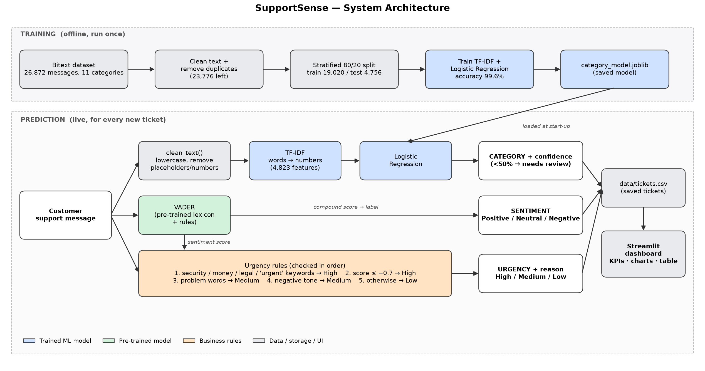

# SupportSense — AI-Powered Customer Support Ticket Intelligence

[](https://share.streamlit.io/deploy?repository=aman01k/Support_Sense&branch=main&path=streamlit_app.py)

An NLP system that reads a customer support message and predicts:

| Output | How |
|---|---|
| **Category** (11 types, e.g. REFUND, PAYMENT, ACCOUNT) | TF-IDF + Logistic Regression, trained on the Bitext dataset |
| **Sentiment** (Positive / Neutral / Negative) | VADER, a pre-trained sentiment analyser |
| **Urgency** (High / Medium / Low) + reason | Keyword business rules + sentiment score |

A Streamlit dashboard shows all tickets, most urgent first.

**Team:** Aman (230065) · Shashwat (230127)

## Live demo

This app is designed to deploy on [Streamlit Community Cloud](https://streamlit.io/cloud). After the repository is connected, the shareable app URL will be:

**https://support-sense.streamlit.app**

If that URL has not been activated yet, use the **Open in Streamlit** badge above or follow these steps:

1. Sign in to [share.streamlit.io](https://share.streamlit.io).
2. Select `aman01k/Support_Sense`, branch `main`, and file `streamlit_app.py`.
3. Click **Deploy**.
4. Copy the generated `*.streamlit.app` URL and share it.

The app only needs the checked-in model and data files; no secrets are required.



## Results
| Feature | Test set | Score |
|---|---|---|
| Category | 4,756 unseen Bitext messages | **99.6% accuracy, 0.997 macro F1** |
| Sentiment | 36 hand-labelled messages | **94% accuracy** |
| Urgency | 36 hand-labelled messages | **100% accuracy, High recall 100%** |
| Robustness | 18 edge cases (empty, emoji, non-English, HTML…) | **0 crashes** |

## Setup (first time)
```
cd SupportSense
python3 -m venv .venv
.venv/bin/pip install -r requirements.txt
```

## Run the pipeline (in order)
```
.venv/bin/python notebooks/01_explore_data.py       # download + explore dataset
.venv/bin/python notebooks/02_prepare_data.py       # clean + train/test split
.venv/bin/python notebooks/03_train_model.py        # train + evaluate category model
.venv/bin/python notebooks/04_sentiment_urgency.py  # test sentiment + urgency
.venv/bin/python notebooks/05_final_tests.py        # edge-case tests
.venv/bin/python notebooks/06_architecture_diagram.py
```

## Run the dashboard
```
.venv/bin/streamlit run streamlit_app.py
```

## Project structure
```
SupportSense/
├── streamlit_app.py          # dashboard
├── src/
│   ├── preprocessing.py      # clean_text() - shared by training and app
│   ├── predict.py            # category model + confidence check
│   ├── sentiment.py          # VADER sentiment
│   ├── urgency.py            # urgency rules
│   ├── analyzer.py           # analyze_ticket() - runs all three
│   └── storage.py            # tickets.csv load/save
├── notebooks/                # 01-06 step-by-step scripts
├── data/
│   ├── raw/                  # downloaded datasets
│   ├── processed/            # train.csv, test.csv
│   ├── eval/                 # manual_samples.csv (hand-labelled)
│   └── tickets.csv           # tickets saved by the dashboard
├── models/category_model.joblib
├── reports/                  # confusion matrix, metrics, diagram, edge cases
└── docs/                     # step notes, PROJECT_REPORT.md, VIVA_QA.md
```

## Documentation
- [docs/PROJECT_REPORT.md](docs/PROJECT_REPORT.md): full project report
- `docs/SupportSense_Project_Report.docx`: the same report as a Word document. After editing the Markdown, rebuild it with `node tools/build_report_docx.js` (first time: `cd tools && npm install`)
- [docs/VIVA_QA.md](docs/VIVA_QA.md): viva questions and answers
- `docs/01`–`05`: detailed notes for each phase
