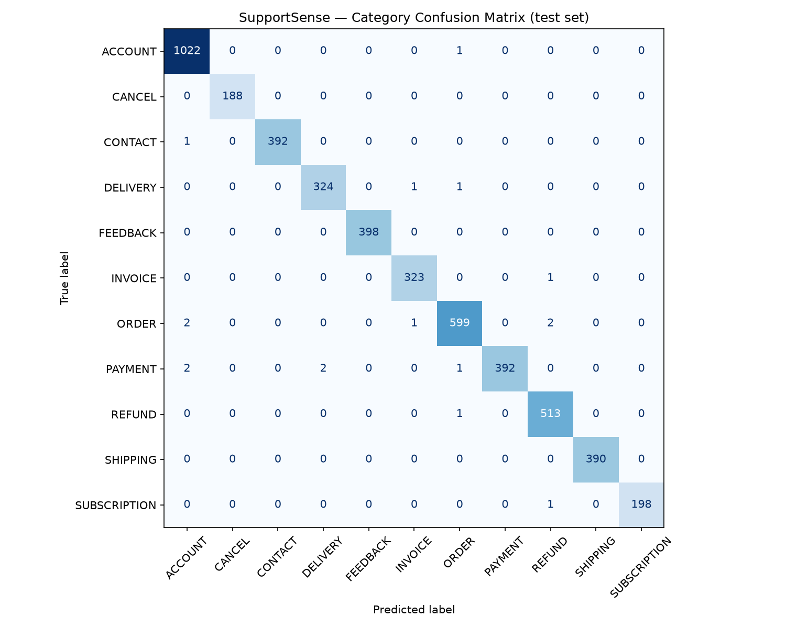

# SupportSense: AI-Powered Customer Support Ticket Intelligence System

**Course:** Natural Language Processing  
**Team members:**  
Aman (Enrollment No. 230065)  
Shashwat (Enrollment No. 230127)  
**Date:** [Submission date]

---

## Abstract
Companies receive large volumes of customer support messages every day. Reading, categorising and prioritising them by hand is slow, and urgent issues can be overlooked. SupportSense is an NLP system that analyses each support message automatically. It predicts the **category** of the problem with a TF-IDF + Logistic Regression classifier trained on the Bitext customer support dataset (99.6% accuracy, 0.997 macro F1 on 4,756 unseen messages). It detects **sentiment** with the pre-trained VADER analyser, and assigns **urgency** (High / Medium / Low) with explainable business rules. Predictions with low confidence are flagged for manual review. Results are shown in a Streamlit dashboard that lists tickets with the most urgent first.

---

## 1. Introduction
Customer support teams handle tickets from email, websites and feedback forms. Each ticket must be read, assigned to the right team and prioritised. Done manually, this:
- delays the first response,
- depends on the agent's judgement, which may be inconsistent,
- risks missing urgent issues such as fraud or double payments when queues are long.

Natural Language Processing can do this first triage automatically, so agents spend their time solving problems instead of sorting them.

## 2. Problem Statement
Given a customer support message in English, automatically determine:
1. **What** the issue is about (category),
2. **How the customer feels** (sentiment),
3. **How urgently** it needs attention (urgency),

and present all tickets in a dashboard that support teams can filter and sort.

## 3. Objectives
1. Build a supervised text classifier for ticket category.
2. Add sentiment analysis and urgency detection.
3. Evaluate each part with suitable metrics.
4. Build an easy-to-use dashboard that integrates all three.
5. Keep the system simple and explainable.

**Out of scope:** chatbots and automatic replies, email integration, user login, automatic agent assignment.

---

## 4. Dataset

### 4.1 Selection
Two public datasets were compared:

| | **Bitext Customer Support (chosen)** | Tobi-Bueck Customer Support Tickets |
|---|---|---|
| Source | Hugging Face | Hugging Face |
| Size | 26,872 English messages | 61,765 (only 28,261 English) |
| Labels | 11 categories, 27 intents | department, priority, type |
| Missing values | None | 3,639 missing subjects |
| Baseline accuracy* | **99.7%** | 52% (department), 62% (priority) |

\*TF-IDF + Logistic Regression, quick test.

The Tobi-Bueck labels were noisy. For example, *"Urgent Help Needed for Possible Data Breach"* is labelled **medium** priority. Bitext was chosen because it is clean, English-only, and its categories match real support teams.

### 4.2 Bitext dataset description
| Column | Description | Used |
|---|---|---|
| `instruction` | Customer message | Input |
| `category` | Ticket category | Target label |
| `intent`, `response`, `flags` | Sub-intent, agent reply, style tags | Not used |

- Messages are short: 8.7 words on average (range 1–16).
- They contain realistic noise: typos ("rtying"), slang ("wanna") and placeholders (`{{Order Number}}`).
- Category distribution (before cleaning):

| Category | Count | Category | Count |
|---|---|---|---|
| ACCOUNT | 5,986 | PAYMENT | 1,998 |
| ORDER | 3,988 | FEEDBACK | 1,997 |
| REFUND | 2,992 | DELIVERY | 1,994 |
| INVOICE | 1,999 | SHIPPING | 1,970 |
| CONTACT | 1,999 | SUBSCRIPTION | 999 |
| | | CANCEL | 950 |

The data is **imbalanced**: ACCOUNT has 6× as many examples as CANCEL.

**Note on label meaning:** in Bitext, CANCEL covers questions about cancellation *fees*, while cancelling an order is in ORDER. SUBSCRIPTION means the *newsletter*, not a paid plan.

### 4.3 Missing labels
Bitext has **no sentiment or urgency labels**. Supervised models for these could not be trained without manually labelling thousands of messages. So sentiment uses a pre-trained model and urgency uses rules (Section 5).

---

## 5. Methodology

### 5.1 Text preprocessing
A single function, `clean_text()`, is used at both training and prediction time, so new messages are cleaned exactly like training data.

| Step | Example |
|---|---|
| Lowercase | "Refund" → "refund" |
| Remove placeholders | "cancel order {{Order Number}}" → "cancel order" |
| Remove numbers | "invoice #12588" → "invoice" |
| Collapse whitespace | |

Deliberately **not** done:
- **Stop-word removal:** it would delete negations ("not", "can't") that change meaning.
- **Spelling correction:** typos are realistic, and the model learns them.
- **Stemming/lemmatisation:** unnecessary for short messages with word-pair features.

### 5.2 Data preparation
| Step | Rows |
|---|---|
| Loaded | 26,872 |
| Empty after cleaning | 0 removed |
| Same text with conflicting labels | 0 removed |
| Duplicates removed | 3,096 removed → **23,776** |
| **Stratified 80/20 split** (`random_state=42`) | **Train 19,020 · Test 4,756** |

Duplicates were removed so the same sentence cannot appear in both train and test (data leakage). Stratification keeps each category's share equal in both sets (e.g. ACCOUNT 21.5% / 21.5%).

### 5.3 Category classification: TF-IDF + Logistic Regression
**TF-IDF (Term Frequency–Inverse Document Frequency)** converts each message into a vector of word scores:

  TF-IDF(word, message) = TF(word, message) × log(N / DF(word))

A word scores high when it is frequent in the message but rare across all messages ("refund"), and low when it appears everywhere ("the").

Settings:
- `ngram_range=(1,2)`: single words and word pairs ("payment methods").
- `min_df=2`: ignore terms seen in only one message.
- `sublinear_tf=True`: dampen repeated words.
- Result: **4,823 features**.

**Logistic Regression** (multinomial) learns a weight per feature per category and outputs a probability for each category (softmax). `class_weight="balanced"` compensates for class imbalance.

Both steps are combined in a scikit-learn **Pipeline**, so TF-IDF is fitted on training data only, and the model is saved as one file (`category_model.joblib`).

### 5.4 Confidence check
The highest class probability is used as a **confidence** score. If it is below **50%**, the ticket is marked **"Needs manual review"**. This catches messages unlike the training data, such as *"I was charged twice"* (23% confidence) or non-English text.

### 5.5 Sentiment analysis: VADER
VADER (Valence Aware Dictionary and sEntiment Reasoner) is a pre-trained, lexicon- and rule-based sentiment analyser for short informal text. It scores ~7,500 words and applies rules for negation, intensifiers, capitals and exclamation marks, producing a **compound score** from −1 to +1.

| Compound score | Label |
|---|---|
| ≥ 0.5 | Positive |
| ≤ −0.05 | Negative |
| otherwise | Neutral |

The Positive threshold is higher than VADER's default (0.05) because polite support requests ("Please tell me how to…", +0.32) are not genuinely positive.

### 5.6 Urgency detection: business rules
Rules are checked in order; the first match wins, and the matching reason is shown:

| # | Rule | Urgency |
|---|---|---|
| 1 | Security (hacked, fraud, unauthorized, without my permission…), money (charged twice, overcharged…), legal (lawyer, sue…) or urgency words (urgent, asap, immediately…) | High |
| 2 | Very negative sentiment (compound ≤ −0.7) | High |
| 3 | Problem words (not working, can't, error, broken, missing, delayed…) | Medium |
| 4 | Any negative sentiment | Medium |
| 5 | Otherwise | Low |

Combining keywords with sentiment covers both calm-but-serious tickets (*"I need access urgently"*) and angry tickets without a keyword. The very-negative threshold was raised from −0.6 to −0.7 after dashboard testing, because *"I chose a wrong address by mistake"* (−0.67) was wrongly marked High.

---

## 6. System Architecture

**Training (offline):** dataset → cleaning and de-duplication → stratified split → TF-IDF + Logistic Regression → saved model.

**Prediction (live):** each message goes through three parallel branches:
1. `clean_text` → TF-IDF → Logistic Regression → category and confidence
2. VADER → sentiment
3. Urgency rules (using the VADER score) → urgency and reason

VADER and the urgency rules use the **raw** text, because capitals, punctuation and placeholders carry tone. The result is saved to `data/tickets.csv` and displayed in the Streamlit dashboard.

---

## 7. Implementation

### 7.1 Tools
| Component | Technology |
|---|---|
| Language | Python 3 |
| Data handling | Pandas |
| Feature extraction, model, metrics | scikit-learn |
| Sentiment | vaderSentiment |
| Dashboard | Streamlit |
| Storage | CSV |
| Plots | Matplotlib |

### 7.2 Code structure
| File | Purpose |
|---|---|
| `src/preprocessing.py` | `clean_text()` |
| `src/predict.py` | Loads model, predicts category + confidence |
| `src/sentiment.py` | VADER wrapper |
| `src/urgency.py` | Urgency rules |
| `src/analyzer.py` | `analyze_ticket()`: combines all three, validates input |
| `src/storage.py` | Save/load tickets |
| `streamlit_app.py` | Dashboard |
| `notebooks/01–06` | Reproducible step-by-step scripts |

---

## 8. Results

### 8.1 Category classification (4,756 unseen test messages)
| Model | Accuracy | Macro F1 |
|---|---|---|
| **Logistic Regression (selected)** | **0.996** | **0.997** |
| Linear SVM | 0.998 | 0.998 |

Per-class results (Logistic Regression):

| Category | Precision | Recall | F1 | Support |
|---|---|---|---|---|
| ACCOUNT | 0.995 | 0.999 | 0.997 | 1,023 |
| CANCEL | 1.000 | 1.000 | 1.000 | 188 |
| CONTACT | 1.000 | 0.997 | 0.999 | 393 |
| DELIVERY | 0.994 | 0.994 | 0.994 | 326 |
| FEEDBACK | 1.000 | 1.000 | 1.000 | 398 |
| INVOICE | 0.994 | 0.997 | 0.995 | 324 |
| ORDER | 0.993 | 0.992 | 0.993 | 604 |
| PAYMENT | 1.000 | 0.987 | 0.994 | 397 |
| REFUND | 0.992 | 0.998 | 0.995 | 514 |
| SHIPPING | 1.000 | 1.000 | 1.000 | 390 |
| SUBSCRIPTION | 1.000 | 0.995 | 0.997 | 199 |

- **17 errors** out of 4,756. Most involve heavy typos ("paymdnt", "invooce", "contactingassistant").
- **Why Logistic Regression over SVM:** the SVM is 0.2% more accurate (about 10 messages), but it does not give probabilities, which the confidence check needs.
- **Most important words** learned per category are sensible, e.g. REFUND: *refund, reimbursement, money, rebate*; CONTACT: *customer, agent, person, speak*.
- **Confidence check:** 74 test tickets (1.6%) fall below 50% confidence. Accuracy is **99.9%** on confident tickets and **82.4%** on flagged ones, so flagging separates reliable from unreliable predictions.

### 8.2 Sentiment and urgency (36 hand-labelled messages)
| Feature | Accuracy | Notes |
|---|---|---|
| Sentiment | 94% | Errors: "overcharged" (not in VADER's lexicon) and "Please refund me immediately…" ("please" offsets the threat) |
| Urgency | 100% | **High recall 100%**: no urgent ticket missed |

On the Bitext test set, the system labels 82% of messages Neutral, 16% Negative and 2% Positive. It labels 80% Low urgency, 20% Medium and 0.1% High. This matches the dataset, which is mostly calm "how do I…" questions.

### 8.3 Robustness (edge cases)
| Input | Behaviour |
|---|---|
| Empty, spaces, one word, None | Rejected with "Please enter at least 2 words" |
| "MY ACCOUNT HAS BEEN HACKED!!! HELP" | ACCOUNT · High (security: hacked) |
| Emoji: "Still no refund 😡😡 this is ridiculous" | REFUND · Negative · Medium |
| Numbers only, Spanish text, "hello there" | Low confidence → flagged for review |
| HTML: ` where is my invoice` | INVOICE, no crash |
| 600-word message | Works |
| Typos: "i cnat acess my acount pls hlep" | ACCOUNT (correct); urgency Low (keywords missed) |
| "Someone else is using my account without my permission" | ACCOUNT · High (security) |

**0 crashes in 18 edge-case tests.**

---

## 9. Dashboard
The Streamlit dashboard provides:
- **Ticket analysis:** text box with example buttons. It shows the category with a confidence bar, urgency with its reason, sentiment with its score, and a "Needs manual review" warning.
- **KPI cards:** total tickets, High priority count, % negative, needs-review count.
- **Charts:** tickets by category, urgency and sentiment.
- **Ticket table:** sorted High urgency first, then newest, with coloured badges. It can be filtered by urgency, sentiment, category, text search and review status, and downloaded as CSV.

*[Insert dashboard screenshots here]*

---

## 10. Limitations
1. **Synthetic training data:** Bitext is template-generated, so its wording is very consistent. Accuracy on real tickets would be lower. Example: *"My package hasn't arrived yet and it has been 10 days"* is predicted ACCOUNT (28% confidence, flagged).
2. **One category per ticket:** *"I need a refund and also want to change my shipping address"* gets only SHIPPING.
3. **Small, self-written sentiment/urgency test set:** 36 messages, written alongside the rules, so the reported scores are optimistic.
4. **Keyword rules are literal:**
   - Negation is missed: *"I was **not** charged twice"* → High.
   - Context is missed: *"my issue is resolved"* → Medium.
   - Typos are missed: "cnat" is not matched as "can't".
5. **VADER limitations:** it misses sarcasm (*"Great, another late delivery"* → Positive) and support jargon ("overcharged", "chargeback").
6. **English only.**
7. **CSV storage** is not suitable for many simultaneous users.

## 11. Future Work
- Train and test on **real** labelled tickets from a company.
- Train a supervised **urgency classifier** from agent-assigned priorities collected over time.
- Fine-tune a **transformer** (e.g. DistilBERT) if real data is noisier and TF-IDF performance drops.
- **Multi-label** classification for tickets with several issues.
- Add negation handling to the urgency rules.
- Replace CSV with **SQLite/PostgreSQL**. Add automatic team assignment and email integration.

## 12. Conclusion
SupportSense shows that a simple, explainable NLP pipeline can automate the first triage of customer support tickets. TF-IDF with Logistic Regression achieves 99.6% accuracy on category prediction, and the confidence check flags messages the model is unsure about. Pre-trained sentiment analysis and transparent urgency rules add the information support teams need to prioritise. The dashboard ensures urgent issues such as fraud and double charges are seen first. The main limitation is the synthetic training data. The modular design allows each component to be replaced with a stronger model when real labelled tickets become available.

---

## References
1. Bitext. *Bitext Customer Support LLM Chatbot Training Dataset.* Hugging Face. https://huggingface.co/datasets/bitext/Bitext-customer-support-llm-chatbot-training-dataset
2. Bueck, T. *Customer Support Tickets.* Hugging Face. https://huggingface.co/datasets/Tobi-Bueck/customer-support-tickets
3. Hutto, C. J., & Gilbert, E. (2014). VADER: A Parsimonious Rule-based Model for Sentiment Analysis of Social Media Text. *Proceedings of ICWSM.*
4. Pedregosa, F. et al. (2011). Scikit-learn: Machine Learning in Python. *Journal of Machine Learning Research, 12*, 2825–2830.
5. Salton, G., & Buckley, C. (1988). Term-weighting approaches in automatic text retrieval. *Information Processing & Management, 24*(5), 513–523.
6. Streamlit documentation. https://docs.streamlit.io
